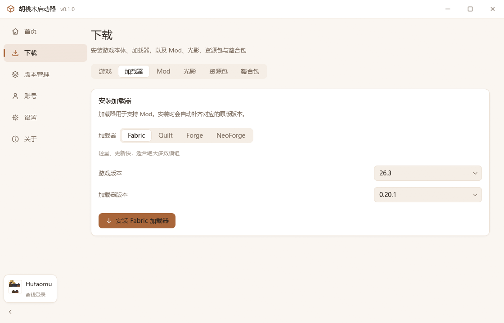
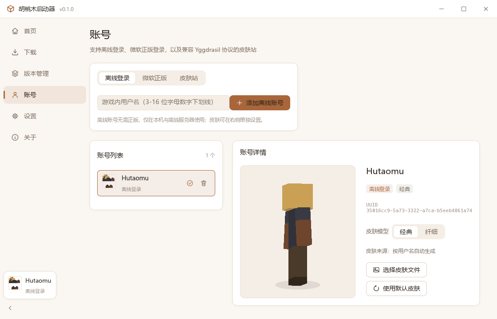
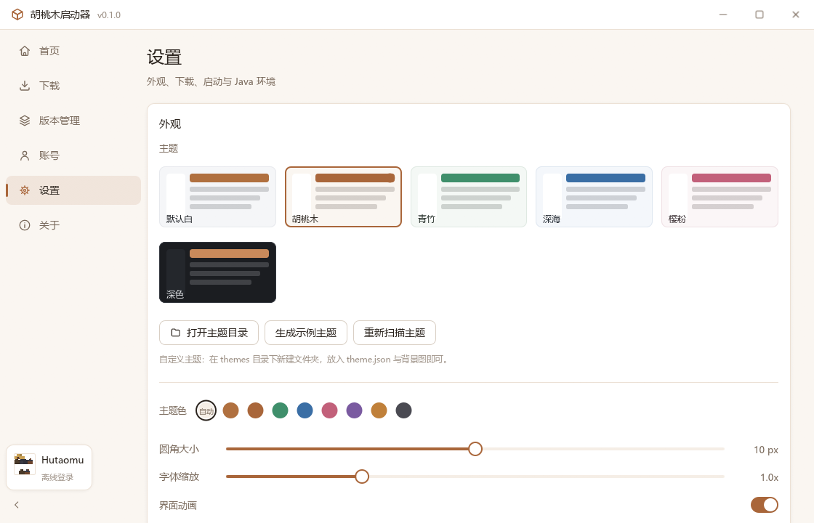

# 胡桃木 Minecraft 启动器 · htmcl

> Hutaomu Minecraft Launcher —— 用 Rust 写的 Minecraft 启动器，单文件分发，配置全部放在启动器同目录。

[](LICENSE)
[](https://www.rust-lang.org/)

---

## 项目简介

htmcl 是一个面向 Windows 的 Minecraft 启动器，界面为简约白色风格，所有图标为项目内自绘的 SVG，不依赖任何 Web 前端框架（不使用 WebView，纯原生窗口 + GPU 渲染）。

发布产物只有一个 `htmcl.exe`，配置、账号、主题、日志与游戏数据全部写在 exe 同目录，删除文件夹即可完全卸载。

## 功能

**游戏与版本**

- 从官方源或 BMCLAPI 镜像下载安装 Minecraft（正式版 / 快照 / 远古版本，共 900+ 版本）
- 依赖库、资源文件、natives 多线程下载，支持 SHA1 校验、断点续传、失败自动重试
- 镜像缺失的文件自动回退官方源
- 版本隔离：每个版本独立的 mods / 存档 / 配置目录
- 单个版本可单独指定内存、Java 与 JVM 参数

**加载器**

- Fabric、Quilt：读取官方 Meta 接口，一键安装
- Forge、NeoForge：自动下载并运行官方安装器，自动识别生成的版本目录

**内容**

- 接入 Modrinth 开放 API，搜索并安装 Mod、光影、资源包、整合包
- 自动安装 Mod 的必需前置依赖
- 支持 `.mrpack` 整合包安装（含 overrides 覆盖）

**账号**

- 离线登录：按 Mojang 规则生成离线 UUID
- 微软正版登录：设备码流程，浏览器完成授权，启动器只保存令牌
- 皮肤站登录：兼容 Yggdrasil / Blessing Skin 协议，默认 `skin.hutaomu.cn`，启动时自动挂载 authlib-injector
- 皮肤管理：本地皮肤文件、皮肤站皮肤、按用户名自动生成默认皮肤
- 3D 皮肤预览：自行实现的轻量 3D 渲染，可拖拽旋转

**Java**

- 简要搜索：注册表、常见安装目录、PATH、JAVA_HOME、官方启动器自带运行时
- 详细搜索：全盘扫描（可取消）
- 按游戏版本自动挑选合适的 Java（1.17+ 需要 17，1.20.5+ 需要 21 等）
- 手动指定 java.exe

**界面**

- 自定义无边框标题栏（最小化 / 最大化 / 关闭自绘）
- 主题系统：6 套内置主题 + 自定义主题（`themes/` 目录）
- 支持静态图片与 GIF 动态背景，可调不透明度与遮罩
- 主题色、圆角、字体缩放可调
- 首页资讯区可绑定自己的 JSON / RSS 资讯源

## 界面

| 首页 | 下载游戏 |
| --- | --- |
|  |  |

| 安装加载器 | Mod 搜索 |
| --- | --- |
|  |  |

| 账号与 3D 皮肤 | 设置 |
| --- | --- |
|  |  |

## 构建

需要 Rust 1.82 或更高版本（使用 MSVC 工具链）。

```bash
git clone https://github.com/qiuxi903/Hutaomu_Minecraft_Launcher.git
cd Hutaomu_Minecraft_Launcher
cargo build --release
```

产物：`target/release/htmcl.exe`。

首次构建会编译 egui、resvg、reqwest 等依赖，耗时较长。生成可执行文件图标（可选，仓库已包含 `assets/htmcl.ico`）：

```bash
cargo run --example gen_icon
```

## 运行

直接双击 `htmcl.exe`。启动器会在同目录生成：

```
htmcl.exe
htmcl.json          # 启动器配置
accounts.json       # 账号（含登录令牌，注意保管）
themes/             # 自定义主题
logs/               # 启动器与游戏日志
.htmcl/             # 缓存（authlib-injector、皮肤、图片、安装器）
.minecraft/         # 默认游戏目录，可在设置中修改
```

### 命令行

```bash
htmcl.exe                      # 正常启动
htmcl.exe --selftest 1.20.1    # 端到端自检：下载、安装、启动并观察游戏日志
htmcl.exe --selftest 1.20.1 fabric   # 额外安装 Fabric 后启动
```

环境变量 `HTMCL_SHOT=<目录>` 会让启动器依次切换各页面截图后退出，用于界面自检。

## 自定义主题

在 `themes/` 下新建文件夹，放入 `theme.json`：

```json
{
  "id": "my-theme",
  "name": "我的主题",
  "dark": false,
  "accent": "#B0703F",
  "bg": "#F5F6F8",
  "surface": "#FFFFFF",
  "surface_alt": "#F1F2F5",
  "border": "#E7E9ED",
  "text": "#1D2025",
  "text_weak": "#6E7681",
  "radius": 10,
  "background": "background.png",
  "background_opacity": 0.35,
  "background_dim": 0.55
}
```

同目录放入 `background.png`（或 `.gif`、`.jpg`）即可作为主题背景。设置页的「生成示例主题」可以直接生成一份模板。

## 目录结构

```
src/
├── main.rs          入口、窗口与命令行
├── app.rs           应用状态、事件循环、标题栏与整体布局
├── selftest.rs      端到端自检
├── icons.rs         SVG 图标光栅化与缓存
├── theme/           主题系统
├── ui/              通用控件、样式与 3D 皮肤预览
├── views/           页面：首页 / 下载 / 版本 / 账号 / 设置 / 关于
└── core/            业务逻辑
    ├── config.rs    配置读写
    ├── paths.rs     目录解析
    ├── download.rs  多线程下载与镜像、系统代理
    ├── java.rs      Java 搜索与校验
    ├── log.rs       日志
    ├── news.rs      资讯（JSON / RSS）
    ├── skin.rs      皮肤解析与默认皮肤生成
    ├── auth/        离线 / 微软 / 皮肤站
    ├── content/     Modrinth 内容
    └── minecraft/   版本解析、安装、启动、加载器
assets/
├── icon.svg         启动器图标源文件
├── htmcl.ico        可执行文件图标（由 icon.svg 生成）
└── icons/           94 个界面图标（自绘 SVG）
```

## 参考项目

本项目在交互设计与功能组织上参考了以下项目，**代码为完全重写，未复制其源码**：

- [SJMCL](https://github.com/UNIkeEN/SJMCL)（MIT）—— 界面布局与信息架构
- [PCL2](https://github.com/Hex-Dragon/PCL2)（自定义许可）—— 版本管理与启动流程
- [HMCL](https://github.com/HMCL-dev/HMCL)（GPL-3.0）—— 加载器安装、Java 搜索与下载源
- [Bakaxl](https://github.com/Bakaxl)（MIT）—— 主题系统与视觉细节

## 使用的开源组件

egui / eframe、reqwest、serde、image、resvg / tiny-skia、zip、md-5 / sha1、uuid、rfd、walkdir、open、chrono、anyhow / thiserror、rand、base64、percent-encoding、num_cpus、windows-sys / winresource。完整清单与许可见启动器「关于」页面。

## 数据来源

Mojang API、BMCLAPI、Fabric Meta、Quilt Meta、MinecraftForge Maven、NeoForged Maven、Modrinth API、authlib-injector。

## 开源协议

[GNU Affero General Public License v3.0](LICENSE)。分发修改后的版本时必须同样以 AGPL-3.0 开源并提供完整源代码。

## 声明

本启动器与 Mojang Studios、Microsoft 无任何关联，「Minecraft」为 Mojang Studios 的商标。启动器不包含任何游戏本体文件，所有游戏资源均在用户操作下从官方或镜像渠道下载。

---

作者：邱息 / [qiuxi903](https://github.com/qiuxi903)
