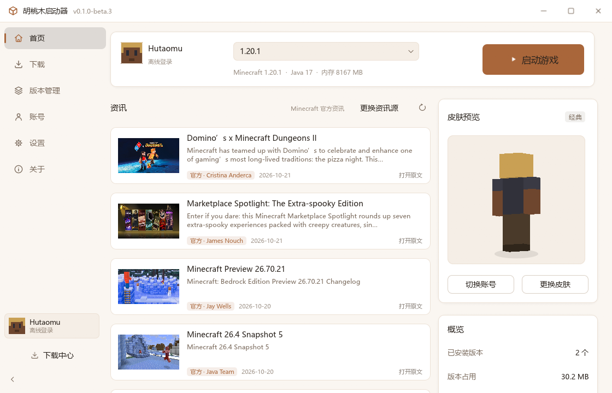
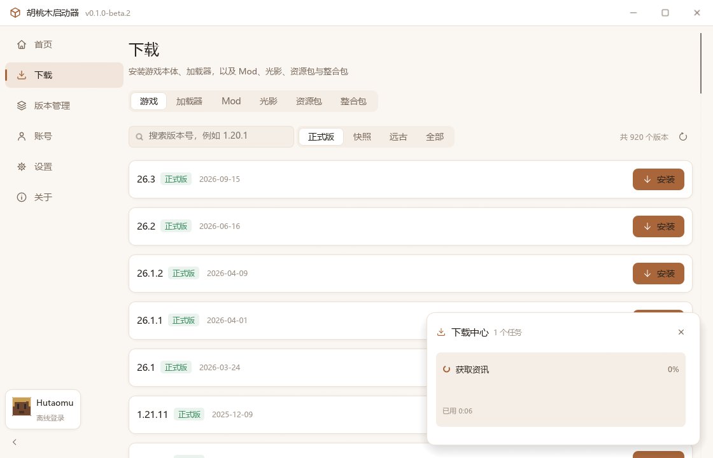
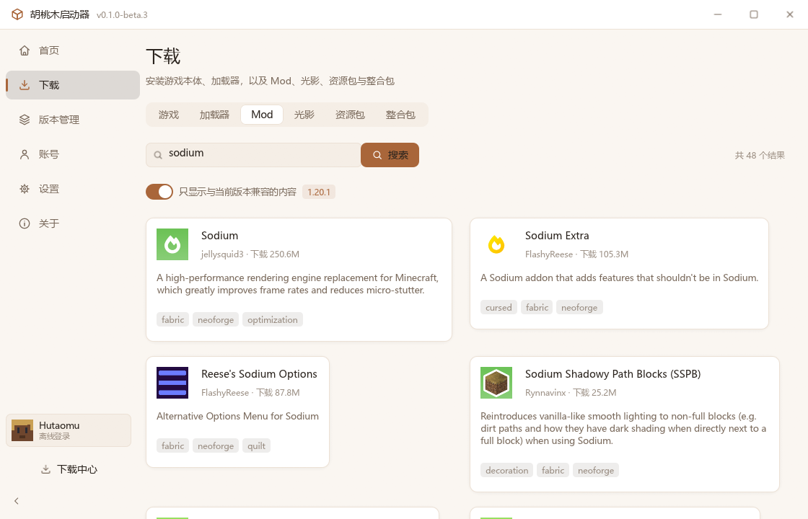
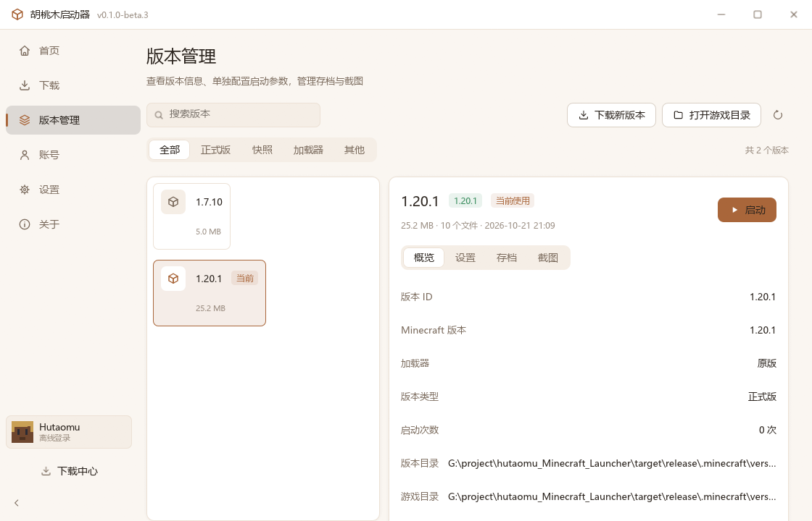
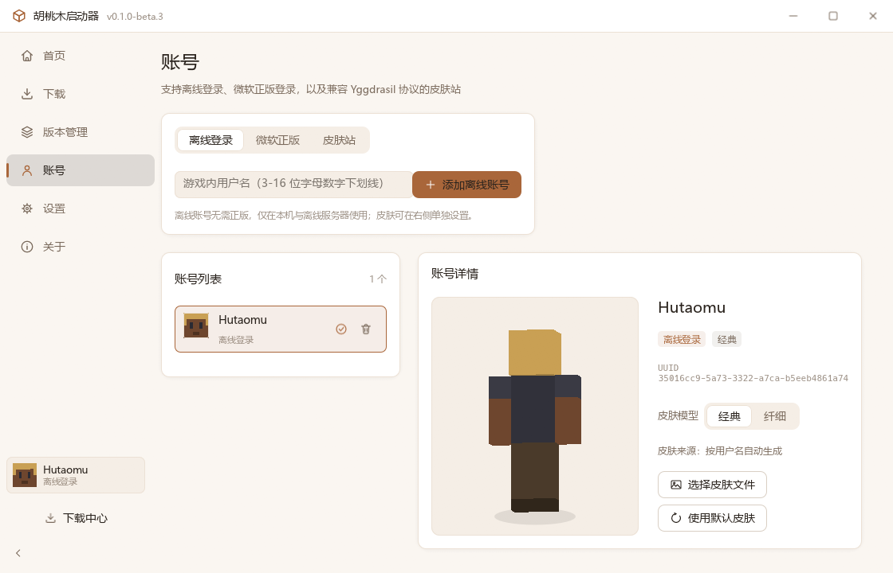
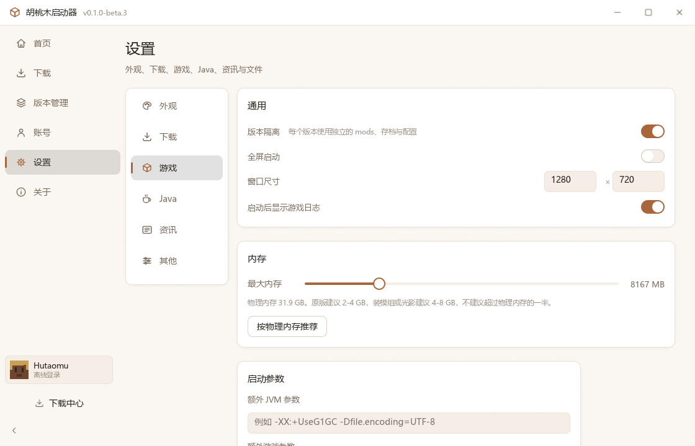
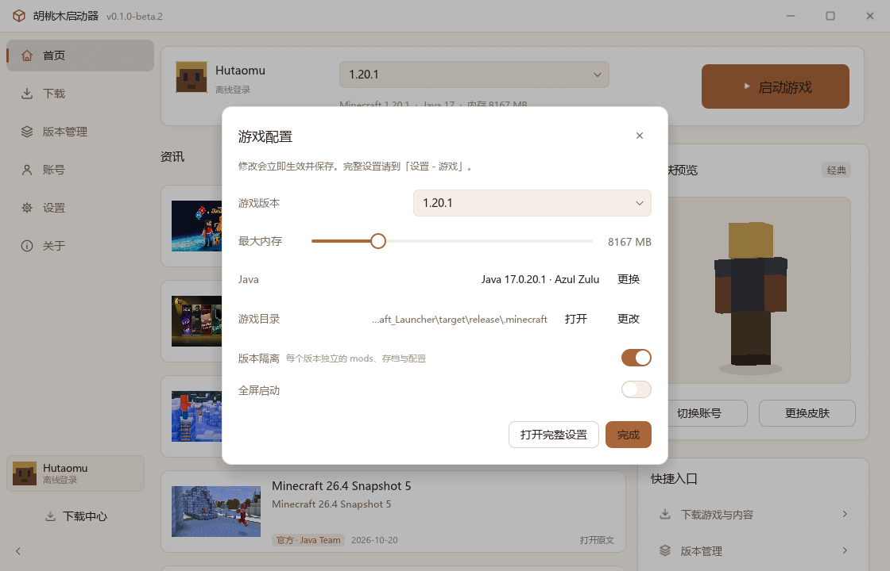
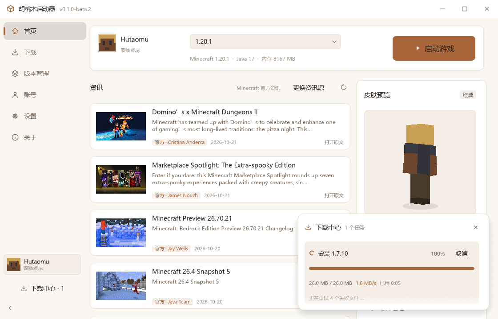
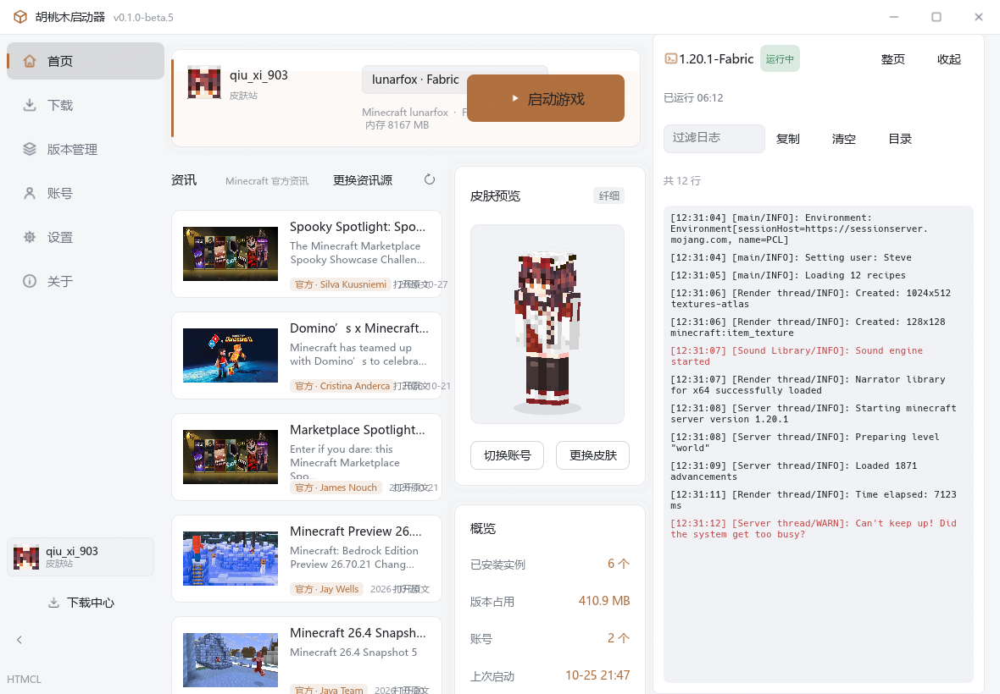
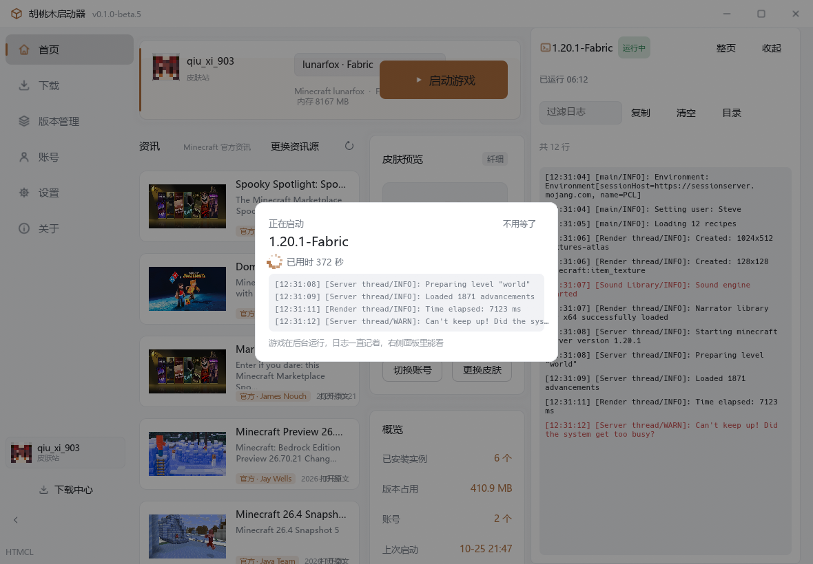

# 胡桃木 Minecraft 启动器 · htmcl

Hutaomu Minecraft Launcher —— 用 Rust 编写的 Windows Minecraft 启动器。单文件分发，配置、账号、主题与游戏数据全部位于启动器同目录；不写注册表，不使用 WebView，界面由 egui 直接在 GPU 上渲染。

[](#开发状态)
[](LICENSE)
[](https://www.rust-lang.org/)
[](#构建)

---

## 下载

**暂未提供发行包。** 项目仍在开发中，正式版发布后会在这里提供下载入口。

从源码构建请见 [构建](#构建)。

---

## 目录

- [开发状态](#开发状态)
- [功能](#功能)
- [界面](#界面)
- [技术栈与架构](#技术栈与架构)
- [构建](#构建)
- [运行与命令行](#运行与命令行)
- [配置文件](#配置文件)
- [数据来源与网络策略](#数据来源与网络策略)
- [已知限制与路线图](#已知限制与路线图)
- [参与开发](#参与开发)
- [参考项目](#参考项目)
- [许可证与声明](#许可证与声明)

---

## 开发状态

项目处于开发阶段，**尚未发布正式版**，Release 页面暂时为空。

- 功能仍在快速迭代，配置文件字段、目录结构与界面布局都可能变化；
- 当前源码版本为 **v0.1.0-beta.5**，正式版发布前请备份 `accounts.json` 与游戏目录；
- 已在真实环境验证：版本下载与安装（含资源文件）、原版启动、Fabric 加载器安装与启动、
  游戏与加载器一次装好、Java 简要搜索、Modrinth 搜索与版本查询、
  CurseForge 搜索、下载、整合包安装与本地文件指纹反查、
  本地光影与资源包反查到线上项目并显示图标、
  模组快捷更新（真的下载新版本并删掉旧文件）、
  MCMod 中文名与官网跳转、三个中文资讯源、皮肤站接口错误处理、全部界面页面；
- **尚未实机验证**：Forge / NeoForge 安装器流程、微软账号登录、皮肤站登录（这三项需要更完整的网络环境或真实账号）；
- 遇到问题请提交 [Issue](https://github.com/qiuxi903/Hutaomu_Minecraft_Launcher/issues)，并附上 `logs/` 下的日志。

## 功能

### 游戏与版本

- 从 Mojang 官方源或 BMCLAPI 镜像获取版本清单（当前 900+ 版本，含正式版、快照、远古版本）；**默认使用国内镜像（BMCLAPI），直连即可**，可在「设置 - 下载」切换为官方源；
- 完整安装流程：版本描述、客户端 jar、依赖库（按 `rules` 过滤平台）、natives 解压、资源索引与资源对象、日志配置、旧版 virtual 资源目录；
- 下载支持多线程并发、SHA1 校验、**断点续传**（HTTP Range，中断后保留分片并从断点继续）、失败重试；镜像缺失的文件自动回退官方源；
- 404 / 403 等永久性错误不再反复重试，只对网络类错误重试；
- 并发线程数由「设置 - 下载」控制，对版本安装、资源下载与内容安装全部生效；
- 版本隔离：每个版本使用独立的 `mods`、`saves`、`config` 目录；
- 单版本可单独覆盖内存、Java 与 JVM 参数；
- 启动参数按版本 JSON 的 `arguments` / `minecraftArguments` 模板展开，兼容 1.6 之前的老版本；
- **游戏日志**：Minecraft 自己把日志写在游戏目录的 `logs/latest.log` 里，
  用 `javaw` 启动时进程没有控制台，标准输出几乎没东西，
  所以这两边一起收：进程输出 + 游戏自己的日志，实时显示在右侧停靠的面板里，
  可按关键字过滤、复制、清空，也能直接打开游戏日志目录；
  启动器自己也留一份 `logs/game-*.log`；
- 启动与游戏真正起来时各有一声轻提示音（自己合成的，不带音频文件，可在设置里关）；
- **下载中心**：右下角悬浮面板显示每个任务的进度、字节数、实时速度、已用时间与当前动作，可随时取消；所有下载与内容安装都会自动弹出。

### 加载器

| 加载器 | 实现方式 |
| --- | --- |
| Fabric | Fabric Meta `profile/json`，写入版本目录并补齐依赖库 |
| Quilt | Quilt Meta `profile/json` |
| Forge | 解析 Maven 元数据，下载官方安装器并执行 `--installClient` |
| NeoForge | 同上；1.20.1 走 `net/neoforged/forge`，更高版本走 `net/neoforged/neoforge` |

**一次装好，无需单独安装**：下载页点击「安装」会弹出安装配置，可同时选择加载器与加载器版本，
由启动器把游戏本体与加载器装到同一个任务里：

- 加载器版本可选**自动选择**（按设置里的「推荐稳定版 / 最新版 / 每次询问」策略挑选）或**手动指定**；
- 安装时机可选「与游戏同时 / 下载完成后 / 不自动安装」，在「设置 - 下载」中配置；
- Fabric / Quilt 只下载自身声明的依赖库，与原版同时开始下载；
  Forge / NeoForge 需要运行官方安装器，等原版核心文件就绪后启动，与资源文件下载并行；
- 加载器页也走同一套管线，可为已安装的游戏补装加载器。

### 内容

接入 [Modrinth](https://modrinth.com) 与 [CurseForge](https://www.curseforge.com) 两个内容平台，
下载页顶部一键切换，两边用的是同一套界面：

- 搜索 Mod、光影、资源包、数据包、整合包，可按当前游戏版本与加载器过滤；
- **切到内容标签即自动加载**，不必手动点搜索；Modrinth 搜索本身支持中文关键词；
- **Mod 名称与 MCMod 对齐**：列表与详情页显示 MC 百科（MCMod）上的中文名与缩写，
  卡片上直接标注 MCMod 链接，点击即可打开对应页面；MCMod 未收录的保持原始名称；
- **详情页**分为「项目信息 / 安装 / 项目介绍」三段：
  - 项目信息含作者、更新时间、下载量、许可证与分类，并提供
    Modrinth 页面 / MCMod 页面 / 源码 / 问题反馈 / Wiki 的直达按钮；
  - **安装默认装到当前实例**，可切换实例，界面直接显示实际安装目录；
    加载器与游戏版本按实例自动筛选，也可手动放宽到「全部」；
  - 项目介绍按 Markdown 渲染为可读文本。
- 列表卡片高度统一，标题与简介按固定行数截断，超长自动省略；
- 分类标签中文化（科技 / 优化 / 装饰 / 玩法 …），加载器名保留原名；
- 详情页可显示中文简介（来自 MC 镜像站翻译接口，失败时自动回退原文，结果本地缓存）；
- 安装到对应目录：`mods/`、`shaderpacks/`、`resourcepacks/`、`datapacks/`；
- Mod 的必需前置依赖自动安装（一层，避免递归）；
- `.mrpack` 整合包：解析 `modrinth.index.json`、按清单下载、写入 `overrides` 与 `client-overrides`；
- **CurseForge 平台**：
  - 官方接口必须带 `x-api-key`，key 可在「设置 - 内容平台」里填，
    也可用环境变量 `CURSEFORGE_API_KEY`；官方发布的版本内置了一把，用户开箱即用；
  - 搜索结果与 Modrinth 同形，分类、加载器筛选、依赖安装、整合包解压都走同一套逻辑；
  - 官方搜索端点偶尔会临时拦截请求并返回 403，此时自动改用社区镜像
    （`api.curse.tools`）兜底，界面上会标明结果来自镜像；
  - **本地文件反查**：按 CurseForge 的 MurmurHash2 指纹算法给已装文件算指纹，
    反查出它属于哪个项目，本地装着的模组、光影与资源包也能给出对应项目页链接；
    认出项目后连项目图标一起取回来，光影、资源包与数据包直接显示线上那张图。

### 版本管理

- **一级页面是所有版本列表**，以等宽等高的卡片排列：
  左边是图标与版本名，下一行是加载器与变体数，中间一条细线隔开，
  底部左边写占用空间、右边写最后修改时间，当前使用的实例在右上角标出来；
  可按最近修改 / 名称 / 占用空间排序；
- **点进去是二级页面**，左侧是导航（概览 / 设置 / 加载器 / 导出 / 存档 / 截图 / 模组 / 光影 / 资源包 / 数据包），
  右侧是内容，版式参考 PCL2-CE：
  - **概览**：加载器与光影状态、实例信息、个性化、快捷方式与高级管理；
    路径这类内部信息不往页面上摆，要看自己点「打开目录」；
  - **设置**：启动选项（版本隔离、窗口标题、Java、启动参数、独立目录）
    与内存分配三档（跟随全局 / 自动 / 自定义），带内存占用条与 -Xmx、-Xms 滑块；
  - **加载器**：列出已装的加载器，可切换当前、可移除（只让删加载器变体，原版是实例底座），
    也能为已装的游戏补装新的加载器；
  - **导出**：勾选游戏本体、模组、资源包、光影、数据包、存档、服务器列表与其它文件夹，
    打包成 zip，解压到 `.minecraft` 就能用；
- **版本图标**按版本类型给不同的方块：正式版草方块、快照命令方块、
  旧版 Beta 圆石、旧版 Alpha 石头、愚人节苦力怕脸，都是自绘的像素画；
  版本目录里放了 `icon.<扩展名>` 就用用户自己那张；
- **个性化**：给实例起名字、写描述、打分类、加收藏，名字会用在卡片与标题上；
  图标可自选，图片复制成 `icon.<扩展名>`，与 HMCL 的约定一致；
- **设置只对该版本生效**：内存、Java、JVM 参数、独立游戏目录与版本隔离开关
  都只作用于当前版本，「恢复全局设置」可一键还原；
- **版本隔离默认开启**：每个版本使用独立的 `mods`、`saves`、`config` 目录；
  可在设置里为单个版本单独关闭；
- **同一个版本可以装多个实例**：下载页里已安装的版本右边有「再装一个」，
  版本详情右上角也有「新建实例」，都能复制一份游戏本体（客户端 jar、natives、版本描述）
  变成新的实例，模组、存档与配置各存各的，互不干扰；
  新实例目录里放一个 `htmcl-instance.json` 标记文件，
  启动器据此把它当成独立实例而不是同版本的另一个变体；
  目录名默认拿版本号加序号（`1.20.1` → `1.20.1-2`），撞上已有的自动往后排；
  原来只有一个实例的用户不需要做任何迁移，行为跟以前完全一样；
- 模组菜单列出该实例已安装的模组，可直接打开目录或跳去下载页；
- **内容**菜单统一管理 **模组 / 光影 / 资源包 / 数据包**，导航里各有专属图标：
  - 模组会解析 jar 内的元数据（`fabric.mod.json`、`mods.toml`、`mcmod.info`），
    并用 MC 百科（MCMod）词库补上中文名，例如 Sodium 显示为「钠」；
  - 光影与资源包没有元数据时去掉文件名末尾的版本号；
  - 每条都显示原始文件名、大小与修改时间，可直接定位到文件位置；
  - 模组可一键跳转到 **MC 百科** 与 **Modrinth** 页面；
    光影与资源包会按文件名反查 Modrinth 项目，命中后同样给出跳转入口；
  - **图标**：模组用 jar 自带的图标，光影、资源包与数据包显示线上项目的图标，
    按文件指纹反查到 CurseForge 项目后优先用那张，没反查到才退回分类图标；
  - **本地缓存**：查过的线上资料存进 `htmcl/cache/content-cache.json`，
    下次打开这一页直接读本地，不再联网反查；
    连「猜不出对应项目」的结果也记下来，一个月内不再重复猜文件名；
  - **快捷更新**：每条内容右下角有更新按钮，点一下就查线上最新版并替换本地文件，
    旧版本会被删掉（两个版本同时躺在目录里，游戏会把它们都加载一遍）；
    标题栏的「全部更新」一键更新整页，按当前实例的 MC 版本与加载器筛选；
  - **银锁**：卡片右上角能上锁，锁住的内容不会被「全部更新」动到，
    标题栏会显示当前锁了几项；
  - 数据包只有 CurseForge 收录，在 Modrinth 搜索时会明确提示换平台。

### 账号

| 类型 | 说明 |
| --- | --- |
| 离线登录 | 按 Mojang 规则生成 UUID：`MD5("OfflinePlayer:" + name)` 并设置 v3 UUID 版本位 |
| 微软正版 | OAuth 2.0 设备码流程 → Xbox Live → XSTS → Minecraft Services → 档案与皮肤 |
| 皮肤站 | Yggdrasil / Blessing Skin 协议，默认 `https://skin.hutaomu.cn/api/yggdrasil`，兼容自定义地址 |

- 皮肤站账号启动时自动下载并挂载 [authlib-injector](https://github.com/yushijinhun/authlib-injector)；
- 皮肤来源优先级：本地 PNG → 账号皮肤 → 按用户名程序化生成的默认皮肤；
- 支持经典（4px 手臂）与纤细（3px 手臂）两种模型，可自动识别；
- 3D 皮肤预览由项目自行实现（立方体模型 + 纹理映射 + 背面剔除 + 深度排序），支持第二层（帽子 / 外套），可拖拽旋转；
- 账号列表与侧边栏头像取自皮肤头部（含帽子层），而非整张皮肤。

### Java

- **简要搜索**：注册表 `JavaSoft`、常见厂商目录（Zulu / Temurin / Microsoft / Corretto / Semeru / GraalVM / Liberica / Dragonwell 等）、`JAVA_HOME`、`PATH`、官方启动器自带运行时；
- **详细搜索**：遍历所有固定磁盘查找 `bin/java.exe`，跳过系统与缓存目录，支持随时取消；
- 解析 `java -version` 得到版本、主版本、位数与厂商；
- 按游戏版本自动匹配：1.17+ → 16+、1.18+ → 17+、1.20.5+ → 21+；2026 起的 `26.x` 版本号视为 21+；
- **自动选择 Java**：没手动指定时，启动器按游戏版本挑一把主版本刚够用的 Java，
  实例页的 Java 下拉第一项就是「自动选择」，并标出会挑中哪一把；
- 手动选了一把带不动的 Java 会当场提醒，启动前再校验一次主版本，不够就拦下并说明；
  「设置 - 游戏」里可以关掉这项检查；
- 设置页的 Java 列表按当前选中的游戏版本排序，推荐项标「推荐」，偏旧的标「版本偏旧」；
- 支持手动指定 `java.exe`，搜索结果缓存到配置。

### 界面与主题

- 无边框窗口，最小化 / 最大化 / 关闭按钮自绘，支持拖动与双击最大化；Windows 11 下使用 DWM 圆角；
- 94 个 24×24 线性 SVG 图标，构建时内嵌进可执行文件，无 emoji；
- 6 套内置主题 + `themes/` 目录下的自定义主题；
- 支持静态图片与 GIF 动态背景，可调不透明度与内容遮罩；
- 首页按「启动区 + 资讯 + 皮肤预览」组织：启动是最主要的动作放在首屏顶部，资讯作为主内容区，皮肤与快捷入口在右栏；
- 首页的「游戏配置」是二级弹窗，通用游戏设置集中在「设置 - 游戏」，按通用 / 内存 / 启动参数 / 游戏目录分类；
- **启动过场**：点启动后盖一层半透明遮罩，中间一张小卡片写着版本、已用时与刚冒出来的几行日志，
  底下照样看得见启动器，不会把整个窗口涂成一片空白；「不用等了」随时可以收起来；
- **游戏日志停靠在右边**：游戏跑起来后右侧固定一块日志面板，版本、状态、已运行时长与实时日志都在里面，
  收起来时右边缘留一个小标签；**游戏一关，日志面板、整页日志与小标签全部消失**，
  界面回到干净的样子，崩溃原因改用气泡提示告诉你崩溃报告放在哪；
- 提示条摆在窗口下方中间：右下角让给下载中心，右边让给日志面板；
- **弹窗可以拖着走**：所有弹窗的标题栏按住就能拖，位置按标题记住；
  下载中心那个悬浮面板也能拖到任意位置，偏移记在配置里，下次打开还在原位；
- 设置页使用左侧分类导航（外观 / 下载 / 游戏 / Java / 资讯 / 其他）；
- **关于页**按「应用信息 + 功能验证与运行环境 + 参考项目 + 开源组件与数据来源」分段排开，
  组件许可、接口域名与参考项目许可证都列得整整齐齐，运行环境一键打开对应目录；
- 界面动效：按钮悬停与按压插值、侧栏选中指示条、页面切换淡入、首页卡片依次落位、
  弹窗与下拉展开动画、提示条滑入、资讯卡片与账号行悬停；
  动效时长只有五档（按压 / 悬停 / 状态变化 / 入场 / 淡出），全应用统一，
  关掉「界面动画」后所有过渡直接到终态；
- 主题色、圆角、字体缩放、界面动画均可调整；
- 内置三个中文资讯源：Minecraft 官方资讯（与 PCL2-CE 同源）、苦力怕论坛 RSS、中文 Minecraft Wiki 最近更改；也可切换为自定义 JSON / RSS 地址。

## 界面

| 首页：启动区 + 资讯 | 下载游戏 |
| --- | --- |
|  |  |

| Mod 搜索 | 版本管理 |
| --- | --- |
|  |  |

| 账号与 3D 皮肤 | 设置（左侧分类） |
| --- | --- |
|  |  |

| 游戏配置（二级弹窗） | 下载中心 |
| --- | --- |
|  |  |

| 游戏日志（右侧停靠） | 启动过场 |
| --- | --- |
|  |  |

## 技术栈与架构

### 技术选型

| 领域 | 选择 | 原因 |
| --- | --- | --- |
| 语言 | Rust 2021 | 单文件静态分发，无运行时依赖 |
| GUI | egui / eframe 0.35（glow） | 即时模式，便于自绘控件与标题栏；不引入 WebView |
| HTTP | reqwest（blocking + native-tls） | 在后台线程同步下载，避免引入异步运行时 |
| 图片 / GIF | image | 皮肤、背景与动态背景帧解码 |
| SVG | resvg / tiny-skia | 图标按主题色光栅化并缓存 |
| 压缩包 | zip | natives 解压与 `.mrpack` |
| 哈希 | md-5 / sha1（RustCrypto） | 离线 UUID 与文件校验 |
| 指纹 | murmur2 | CurseForge 本地文件反查项目 |
| 平台 | windows-sys / winresource | DWM 圆角、注册表读取、exe 图标资源 |

### 模块结构

```
src/
├── main.rs              入口、窗口选项、命令行解析
├── app.rs               应用状态、事件循环、页面路由、标题栏、任务与图片队列
├── selftest.rs          端到端自检
├── icons.rs             SVG 光栅化与纹理缓存
├── theme/mod.rs         主题定义、调色板推导、背景帧加载
├── ui/
│   ├── mod.rs           字体注入（系统中文字体）与 egui 样式安装
│   ├── widgets.rs       通用控件：按钮、输入框、开关、下拉、滑块、模态、Toast 等
│   └── skin3d.rs        软件 3D 皮肤渲染
├── views/               首页 / 下载 / 版本管理 / 账号 / 设置 / 关于
└── core/                业务逻辑（不依赖 UI）
    ├── config.rs        配置模型与原子写入
    ├── paths.rs         目录解析与校验
    ├── download.rs      多线程下载、断点续传、镜像重定向、系统代理、进度
    ├── java.rs          Java 搜索与版本匹配
    ├── log.rs           文件 logger 与内存日志缓冲
    ├── news.rs          资讯解析（JSON / RSS / Atom）
    ├── skin.rs          皮肤解析与默认皮肤程序化生成
    ├── auth/            offline / microsoft / authlib
    ├── content/         内容平台：modrinth / curseforge、整合包、缓存与更新
    └── minecraft/       manifest / version / install / launch / loaders / bundle
```

`core` 不引用任何 UI 类型；UI 通过后台任务与 `CoreEvent` 与业务层通信。

### 线程与事件模型

- UI 运行在主线程（winit 事件循环 + egui）；
- 所有网络与文件操作在 `std::thread` 工作线程执行；
- 工作线程通过 `mpsc::Sender<CoreEvent>` 回传结果与进度，`App::handle_events` 每帧 `try_recv()` 消费；
- 工作线程持有 `egui::Context` 克隆，发送事件后调用 `request_repaint()` 唤醒界面；
- 下载进度使用 `Arc<DownloadProgress>`（原子计数 + 消息锁），由独立的观察线程按 180ms 推送；
- 远程图片使用固定的 3 个工作线程 + 共享队列，避免为每张图新建连接。

### 关键设计

**版本继承**：加载器版本通过 `inheritsFrom` 指向原版。解析时沿链递归加载并合并（库列表拼接、参数拼接、其余字段子版本优先），最终得到可用于启动的完整描述。

**规则求值**：库与参数中的 `rules` 按 `os.name` / `os.arch` / `os.version` 与 features 求值，仅保留 Windows x64 且不含 demo / quick-play 特性的条目。

**下载批次分级**：

- 核心文件（主 jar、依赖库、natives、资源索引、日志配置）采用严格批次，任一失败即报错；
- 资源对象采用宽松批次，允许部分失败并写入 `InstallReport`，界面提示缺失数量，可重新安装补齐；
- 失败文件达到阈值时熔断，避免在网络不可用时长时间重试。

**统一安装管线**（`core/minecraft/bundle.rs`）：把「游戏本体」与「加载器」合成一次任务。

- 先落盘原版版本 JSON（加载器的 `inheritsFrom` 依赖它），再决定加载器版本（按策略自动挑选或用户指定）；
- Fabric / Quilt 只下载自身声明的依赖库，与原版核心文件同时开始；
- Forge / NeoForge 需要运行官方安装器，等原版核心文件就绪后启动，与资源文件下载并行；
- 进度采用累加语义，多条并行线程共享同一个 `DownloadProgress` 而互不覆盖；
- 同一目标文件由文件占用锁串行化，避免游戏与加载器并行时写坏同一个文件。

**断点续传**：下载中的文件写在 `xxx.part` 分片里，中断后保留分片；
下次请求带上 `Range: bytes=<已下载长度>-`，服务器返回 206 时接着写并把已下载部分计入哈希；
服务器不支持续传（返回 200）时自动改为整份重下，不会写坏文件。

**网络策略**：同一文件准备「镜像地址 + 原始地址」两个候选，镜像 404 时自动回退官方；镜像站始终直连，其余主机在启用时走系统代理（环境变量优先，其次 Windows 注册表）。404 / 403 等永久性错误会被识别出来直接放弃，不再反复重试。

**3D 皮肤渲染**：把皮肤纹理映射到 6 个立方体（头、身、双臂、双腿），每帧做 Yaw/Pitch 旋转、背面剔除与按面深度排序，写入 `egui::Mesh` 后提交给 GPU。

## 构建

### 环境要求

- Rust 1.82 或更高（开发与验证使用 1.94.0，MSVC 工具链）
- Windows 10/11 x64
- 首次构建需要编译 egui、resvg、reqwest 等依赖，耗时较长

### 命令

```bash
git clone https://github.com/qiuxi903/Hutaomu_Minecraft_Launcher.git
cd Hutaomu_Minecraft_Launcher

cargo build            # 调试构建
cargo build --release  # 发布构建
```

产物：`target/release/htmcl.exe`（约 13 MB，已 strip 并启用 thin LTO）。

### 内置 CurseForge API Key（可选）

CurseForge 的官方接口必须带 `x-api-key`。启动器可以在「设置 - 内容平台」里填一把，
也可以用环境变量 `CURSEFORGE_API_KEY`；两者都没有时，还可以**在编译期把 key 编进 exe**：

```bash
# 方式一：放在 secret/ 目录下（该目录已在 .gitignore 里，不会进仓库）
mkdir -p secret
echo -n '你的 key' > secret/curseforge_key.txt
cargo build --release

# 方式二：走环境变量（CI 里常用）
set HTMCL_CURSEFORGE_KEY=你的key
cargo build --release
```

key 由 `build.rs` 在编译时读出来写进生成文件，源码里不写。
这样官方发布的版本是开箱即用的，而从仓库拉下来自己编译的人不会替作者白烧接口额度 ——
这种情况下 CurseForge 功能需要自己填一把 key。

### 可执行文件图标

仓库已包含 `assets/htmcl.ico`。修改 `assets/icon.svg` 后重新生成：

```bash
cargo run --example gen_icon
```

该示例会用 resvg 渲染 16/24/32/48/64/128/256 多个尺寸并组装 ICO。

## 运行与命令行

直接运行 `htmcl.exe` 即可。首次启动会在同目录创建配置文件与缓存目录。

```bash
htmcl.exe                            # 正常启动
htmcl.exe --selftest                 # 端到端自检（默认验证 1.20.1）
htmcl.exe --selftest 1.20.1          # 指定版本
htmcl.exe --selftest 1.20.1 fabric   # 额外安装 Fabric 后启动
htmcl.exe --selftest 1.20.1 fabric --install-only   # 只安装不启动，用于验证安装管线
```

环境变量：

| 变量 | 作用 |
| --- | --- |
| `HTMCL_SHOT=<目录>` | 依次切换 34 个界面场景截图后退出，用于界面回归自检 |

自检会真实执行：获取版本清单 → 搜索 Java → 通过统一安装管线下载安装（可带加载器）→ 构建启动命令 → 启动并观察 90 秒 → Modrinth 搜索与版本查询 → CurseForge 搜索、详情、依赖、下载与指纹反查 → 本地光影与资源包反查线上项目 → CurseForge 整合包下载解压并读清单 → 光影加载器安装 → 资讯源与皮肤站接口。`--install-only` 会跳过启动游戏那一步。

## 配置文件

启动器数据全部位于 `htmcl.exe` 同目录的 `htmcl/` 文件夹；游戏数据默认在 `.minecraft/`：

```
htmcl.exe
htmcl/
├── htmcl.json      启动器配置
├── accounts.json   账号（含明文令牌）
├── themes/         自定义主题
├── logs/           启动器与游戏日志
└── cache/          authlib-injector、皮肤、图片、安装器等缓存
.minecraft/         默认游戏目录（可在设置中修改）
```

旧版本（配置直接放在 exe 同目录）首次启动时会自动迁移到 `htmcl/`，不会覆盖已有数据。

`htmcl/cache/` 下的 `content-cache.json` 是模组、光影与资源包的线上资料缓存，
删掉它只是下次打开重新查一遍，不影响已经装好的内容。

### htmcl.json

```jsonc
{
  "schema": 1,
  "game_dir": "D:/Games/.minecraft",
  "selected_version": "1.20.1",
  "selected_account": "35016cc9-5a73-3322-a7ca-b5eeb4861a74",

  "java": {
    "auto": true,
    "path": null,               // 指定 java.exe；null 表示按版本自动选择
    "memory_mb": 4096,
    "jvm_args": ""
  },

  "launch": {
    "fullscreen": false,
    "width": 1280,
    "height": 720,
    "extra_args": "",           // 额外游戏参数，例如 --server example.com
    "isolation": true,          // 版本隔离
    "show_game_log": true
  },

  "download": {
    "source": "bmclapi",        // "bmclapi" | "official"，默认国内镜像
    "threads": 8,                // 并发下载线程数
    "timeout_secs": 30,
    "auto_install_dependencies": true,
    "use_system_proxy": true,
    "default_loader": "none",    // "none" | "fabric" | "quilt" | "forge" | "neoforge"
    "loader_policy": "stable",   // "stable" | "latest" | "ask"
    "loader_timing": "parallel", // "parallel" | "after" | "manual"
    "auto_select_after_install": true,
    "install_assets": true       // 是否下载音效、语言、材质等资源文件
  },

  "ui": {
    "theme": "light",
    "accent": null,             // 形如 "#B0703F"；null 表示跟随主题
    "radius": 10,
    "font_scale": 1.0,
    "background": {
      "kind": "none",           // "none" | "image"
      "path": null,
      "opacity": 0.35,
      "dim": 0.55
    },
    "sidebar_collapsed": false,
    "window_size": [1120, 720],
    "animations": true
  },

  "news": {
    "enabled": true,
    "url": "",                  // 留空显示内置使用提示
    "refresh_minutes": 60,
    "last_fetch": null
  },

  "java_cache": [],
  "version_overrides": {
    "1.20.1": { "memory_mb": 8192, "java_path": null, "jvm_args": "", "game_dir": null }
  }
}
```

写入采用「临时文件 + 重命名」，避免中途崩溃损坏配置。

### accounts.json

```jsonc
{
  "selected": "<uuid>",
  "accounts": [
    {
      "kind": "offline",
      "id": "<uuid>",
      "name": "Steve",
      "skin_path": null,
      "skin_model": "classic",
      "created_at": 0
    },
    {
      "kind": "microsoft",
      "id": "<uuid>", "name": "...", "uuid": "<uuid>",
      "access_token": "...", "refresh_token": "...",
      "expires_at": 0, "xuid": "...",
      "skin_path": null, "skin_model": "slim", "skin_url": null
    },
    {
      "kind": "authlib",
      "id": "<uuid>", "name": "...", "uuid": "<uuid>",
      "access_token": "...", "client_token": "...",
      "server_url": "https://skin.hutaomu.cn/api/yggdrasil",
      "skin_path": null, "skin_model": "classic",
      "expires_at": 0, "skin_url": null
    }
  ]
}
```

> 令牌以明文保存。请勿把 `accounts.json` 提交到任何仓库，也不要分享整个启动器目录。

### 主题

在 `themes/` 下新建文件夹，放入 `theme.json`（设置页的「生成示例主题」可直接生成模板）：

```jsonc
{
  "id": "my-theme",
  "name": "我的主题",
  "dark": false,
  "accent": "#B0703F",
  "bg": "#F5F6F8",
  "surface": "#FFFFFF",
  "surface_alt": "#F1F2F5",
  "border": "#E7E9ED",
  "text": "#1D2025",
  "text_weak": "#6E7681",
  "radius": 10,
  "background": "background.png",  // 相对主题目录，支持 png / jpg / gif / webp / bmp
  "background_opacity": 0.35,
  "background_dim": 0.55
}
```

主题色与圆角会被 `htmcl.json` 中的用户覆盖值覆盖（如果设置过）。

## 数据来源与网络策略

| 来源 | 用途 |
| --- | --- |
| `piston-meta.mojang.com` / `piston-data.mojang.com` | 版本清单、版本描述、客户端 jar、日志配置 |
| `resources.download.minecraft.net` | 资源对象 |
| `libraries.minecraft.net` | 依赖库 |
| `bmclapi2.bangbang93.com` | 上述内容的国内镜像 |
| `meta.fabricmc.net` / `meta.quiltmc.org` | 加载器版本与 profile |
| `maven.minecraftforge.net` / `maven.neoforged.net` | 加载器版本与安装器 |
| `api.modrinth.com` | Mod / 光影 / 资源包 / 整合包 |
| `api.curseforge.com`、`api.curse.tools` | CurseForge 内容、文件、依赖、指纹反查 |
| `login.microsoftonline.com`、`xsts.auth.xboxlive.com`、`api.minecraftservices.com` | 微软登录 |
| `authlib-injector.yushi.moe` | authlib-injector 最新版本 |
| 皮肤站 Yggdrasil API | 皮肤站登录与皮肤 |
| `net-secondary.web.minecraft-services.net` | Minecraft 官方中文资讯 |
| `klpbbs.com` | 苦力怕论坛 RSS |
| `zh.minecraft.wiki` | 中文 Minecraft Wiki 最近更改 |

说明：

- 所有下载文件都带 SHA1 校验（源未提供校验值的除外）；
- 镜像站（`*.bangbang93.com`）始终直连，其余主机在启用时走系统代理；
- Modrinth 请求携带带项目名的 User-Agent；
- 启动器不包含任何游戏资源，全部在用户操作下按需下载。

## 已知限制与路线图

**已知限制**

- 仅面向 Windows x64；其他平台未经测试；
- Forge / NeoForge 安装器流程、微软登录、皮肤站登录尚未实机验证；
- 不支持 OptiFine 安装、Mod 更新检查、存档 / 世界下载；
- 下载中断后不会复用 `.part` 文件，只按 SHA1 跳过已完成文件；
- 资源 CDN 不稳定时可能出现部分资源缺失，重新安装可补齐；
- 版本重命名不会自动修正指向它的子版本（`inheritsFrom`），重命名基础版本后需重新安装相关加载器版本；
- 资讯源依赖第三方站点可用性，接口变化时需要更新解析逻辑；
- 下载中心只保留进行中的任务，完成后不保留历史记录。

**路线图**

1. 实机验证 Forge / NeoForge 安装器，补齐失败场景的错误提示；
2. OptiFine 安装；
3. Mod 更新检查与批量管理；
4. 下载断点续传与下载历史。

## 参与开发

- 提交前保证 `cargo build` 与 `cargo build --release` 均通过且**无警告**；
- 代码风格遵循 rustfmt；`core` 不得依赖 `ui` / `views`；
- 提交说明使用 `类型: 内容`，类型为 `feat` / `fix` / `ui` / `docs` / `build` / `refactor`；
- 涉及下载、安装、启动的改动，请先跑 `htmcl.exe --selftest` 验证；
- 涉及界面的改动，可用 `HTMCL_SHOT` 生成截图自查；
- **不要提交** `logs/`、`AI协作规则.md`、`secret/`、`htmcl.json`、`accounts.json`、`themes/`、`.minecraft/`、`target/`；
- 新增第三方依赖需在 PR 中说明用途，并在「关于」页面补充许可信息。

## 参考项目

在交互设计与功能组织上参考了以下项目，**代码为完全重写，未复制其源码**：

- [SJMCL](https://github.com/UNIkeEN/SJMCL)（MIT）—— 界面布局与信息架构
- [PCL2](https://github.com/Hex-Dragon/PCL2)（自定义许可）—— 版本管理与启动流程
- [HMCL](https://github.com/HMCL-dev/HMCL)（GPL-3.0）—— 加载器安装、Java 搜索与下载源
- [Bakaxl](https://github.com/Bakaxl)（MIT）—— 主题系统与视觉细节
- [PCL2-CE](https://github.com/PCL-Community/PCL-CE)（GPL-3.0）—— 版本管理的信息架构与内置资讯源

## 许可证与声明

本项目以 [GNU Affero General Public License v3.0](LICENSE) 开源。分发修改后的版本时，必须同样以 AGPL-3.0 授权并提供完整源代码。

本启动器与 Mojang Studios、Microsoft 无任何关联，「Minecraft」为 Mojang Studios 的商标。启动器不包含任何游戏本体文件。

---

作者：邱息 / [qiuxi903](https://github.com/qiuxi903)
